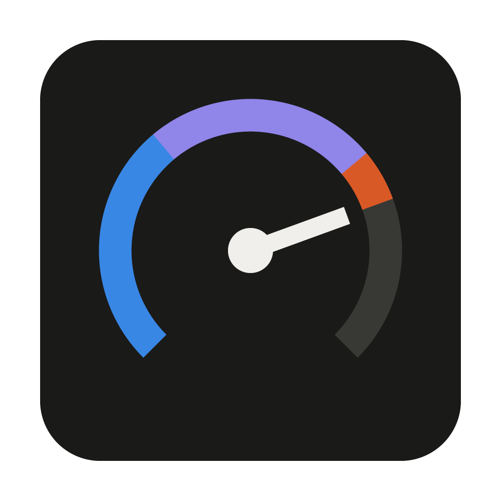

# Device Monitor

A desktop app (Windows and macOS) in the style of NZXT CAM that shows CPU, GPU, memory, temperatures, disks and network for all your machines in one window.



## Install

Run **`dist\Device Monitor Setup <version>.exe`** on Windows (or download it from your hub at `http://<hub>:7777/download`), or **`Device Monitor.dmg`** on a Mac (see [Mac](#mac)). It installs for your user only (no admin), adds Start menu and desktop shortcuts, and opens the app.

On first launch, pick a role:

- **Host the dashboard here** on your main PC. It runs the hub, monitors itself, and serves the dashboard to other devices. Windows asks once for admin approval so other devices can connect.
- **Connect to a hub** on every other PC. Hubs on your network are found automatically, or you can type the address. That PC is then registered and can view the dashboard too.

The app starts when you sign in and opens its window (Windows can take up to a minute after sign-in to start it). Closing the window keeps it monitoring in the system tray. The **⚙ Settings** button (top-right of the app window) lets you:

- see whether this computer hosts or which hub it's connected to
- copy the dashboard link
- change setup (switch between Host and Connect)
- allow network access
- turn start-at-sign-in on or off, or start minimized to the tray instead of opening the window
- turn automatic updates on or off
- quit

The tray menu has the same options.

## Using the dashboard

- **Reorder** cards by dragging the ⋮⋮ grip. The order is saved on the hub, so it's the same on every screen.
- **Chart range**: 10 min / 60 min / 6 h in the header.
- **History**: the History button, a card's ⋯ menu, or clicking a card's chart. Pick 1 h to 30 days, hover to inspect, drag across a chart to zoom, double-click to reset. History is stored on the hub (2-second samples for the last hour, 1-minute averages for 30 days).
- **Advanced**: electricity use and cost for each device and in total over 24 hours, 7 days or 30 days. It shows what each device is drawing now, an hour-by-hour or day-by-day energy chart, and a projected monthly cost. It also has usage totals: time online, average and peak load, peak temperatures, data downloaded and uploaded, and disk reads and writes.
- **⚙ Settings** (in the app and in a browser): °C or °F, and your electricity price. The price starts as a typical home rate for where you are, guessed from your time zone. Pick your state or country, or type the rate from your bill. The price is saved on the hub, so every screen uses it.

Power is an estimate of what each device draws from the wall:
- **Measured:** NVIDIA GPU power, and CPU power where there's a sensor (LibreHardwareMonitor on Windows, NVIDIA Grace or RAPL on Linux).
- **Estimated:** an unmeasured CPU (from its load), plus the rest of the system and power-supply losses.

Expect it to be within about 20% of a plug-in power meter.

## Pushing updates to all your devices

On the PC that hosts the hub, from this folder:

```
npm run release                      # bumps the patch version, builds, signs, publishes
npm run release -- --version 1.4.0   # or choose the version
```

The hub tells every connected app right away. Each app:
1. downloads the installer
2. checks the signature and SHA-256
3. shows an **Update to x.y.z** button in the header while the window is open. Click it to restart into the new version now
4. otherwise installs on its own as soon as the window is closed to the tray (or after an hour), and restarts in the background

Progress for each device is in **Settings → Updates**, and each card shows its app version (e.g. `v1.2.3 → 1.2.4` while an update is pending).

- **The release key.** The first `npm run release` creates a signing key at `~/.device-monitor/release-key.pem`. It is not in the repo. **Back it up.** Apps only accept updates signed with it. The public half is `build/update-key.pub.pem` and is built into the app.
- **Apps older than 1.2.0** have no updater. Their dashboard shows a notice with a download button, so they need one manual install.
- **Macs** can't install updates themselves without an Apple Developer ID, so they show an "update available" notification that opens the download page.
- **Agents installed with the one-line command** (e.g. on Linux servers) aren't the app, so they don't update this way. Re-run the one-liner to refresh them.

## Mac

The Mac app works like the Windows one: install it, choose **Connect to a hub**, and the Mac is registered and can view the dashboard. A Mac can also be the hub.

The Mac app has to be built on macOS (or by GitHub Actions):

```
npm install
npm run dist:mac      # -> dist/Device Monitor.dmg (universal: Apple Silicon + Intel)
```

Or push this folder to GitHub and run the **Build** workflow (`.github/workflows/build.yml`). It produces both the `.dmg` and the Windows installer.

The app isn't notarized, so the first time you open it, **right-click → Open** (or System Settings → Privacy & Security → Open Anyway). CPU and GPU temperatures on a Mac need `brew install smctemp`; everything else works out of the box without sudo.

## Adding devices

- **Another Windows PC**: install the app and choose **Connect**. If you don't want the full app there, use the one-line command from the dashboard's **+ Add device** dialog. It installs a small background agent with no admin rights needed.
- **Mac / Linux without the app**: run the `curl … | bash` command from **+ Add device**. It installs a background agent (a LaunchAgent on macOS, a systemd user service on Linux) with no sudo needed.

## Viewing from a phone, tablet or browser

Open the hub's address, e.g. `http://192.168.1.20:7777`, on anything on the same network. *Copy dashboard link* in the tray menu gives you the address. For access away from home, use [Tailscale](https://tailscale.com).

## Temperatures

| Sensor | Source |
|---|---|
| NVIDIA GPU temp, power, fan, clock, VRAM | `nvidia-smi` (ships with the driver) |
| CPU temp, motherboard sensors, fan RPM (Windows) | [LibreHardwareMonitor](https://github.com/LibreHardwareMonitor/LibreHardwareMonitor) running in the background |
| CPU temp (Linux) | `coretemp` / `k10temp` / thermal zones |
| AMD/Intel GPU load (Windows) | Windows GPU performance counters |

Windows doesn't expose CPU temperature to normal apps, which is why LibreHardwareMonitor is needed for it.

## Security

Device Monitor is designed for a home network, with remote access over Tailscale.

- **Access key.** The dashboard and its API need the hub's key, except on the hub PC itself. Browsers get it once from the dashboard link (Settings → Dashboard link → Copy, or the Add device dialog) and keep it in an HttpOnly, SameSite=Strict cookie. Desktop apps join with a one-time 6-digit pairing code (valid 10 minutes, 5 tries) or the dashboard link. Agents use the same key to report.
- **Apps check the hub first.** Before sending its key, an app makes the hub prove it knows it (an HMAC of a random challenge), so searching Tailscale peers or an old address can't leak the key.
- **Local addresses only.** The hub refuses connections from outside the local network and Tailscale (public IPv4/IPv6), even if a port is forwarded to it.
- **No cross-site requests.** Changes (POST/PUT/PATCH/DELETE) with another site's Origin are refused, including requests to `127.0.0.1` from web pages.
- **Websites can't reach it.** The hub only answers requests addressed to it by IP address, localhost or this computer's own name. That blocks DNS-rebinding attacks from websites you visit. To use a custom DNS name, add it to `"allowedHosts"` in the hub's `config.json`.
- **Strict pages.** Pages are served with a strict Content-Security-Policy, and every metric an agent reports is validated and re-typed by the hub.
- **App updates** are signed (see above), so tampering on the network can't push code to your devices.
- **One-line installs and downloads use plain HTTP.** Only use them on a network you trust.
- **Firewall.** "Network access" in Settings opens TCP 7777 (dashboard/API) and UDP 7778 (discovery) to the local subnet only, on any network profile (many home networks are marked Public). It also removes the broad any-port rules Windows creates from its own "allow this app" prompt. Tailscale doesn't need any firewall rule.

## Development

```
npm install
npm start          # run the app from source
npm run dist       # build dist\Device Monitor Setup <version>.exe
npm run dist:mac   # build dist/Device Monitor.dmg (run on a Mac)
npm run hub        # headless hub only (e.g. on a home server), dashboard at :7777
```

| Path | Purpose |
|---|---|
| `main.js` | Electron app: window, tray, setup, host/connect modes, firewall, start with Windows |
| `preload.js`, `app/` | Setup screen and offline screen |
| `server.js` | Hub: API, live stream (SSE), installer scripts, dashboard |
| `discovery.js` | LAN auto-discovery (UDP 7778) |
| `security.js` | Input validation, Host checks (anti DNS-rebinding), CSP headers |
| `updater.js`, `build/release.js` | Signed self-updates from the hub; the release command |
| `history.js` | Metric history (raw last hour + 1-minute averages for 30 days, on disk) |
| `power.js` | Power estimates (watts at the wall) used for electricity use and cost |
| `agent-runner.js`, `agent/` | Metric agents (Windows PowerShell, macOS and Linux bash) and their one-line installers |
| `build/test/` | Test fixtures: seeded test hub, macOS command mocks for the Mac agent |
| `public/index.html` | Dashboard UI |
| `build/make-icon.js` | Generates the app and tray icons |

App data is stored in `%APPDATA%\Device Monitor`: `settings.json`, plus `hub\` with the device list and agent token. The installer isn't code-signed, so Windows SmartScreen may show "Windows protected your PC". Click **More info → Run anyway**.
