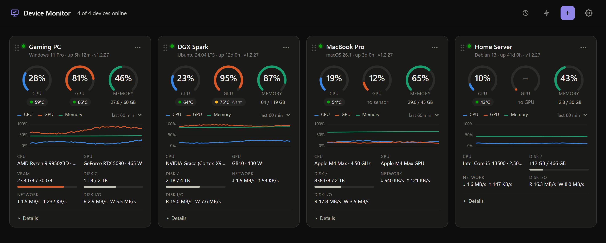
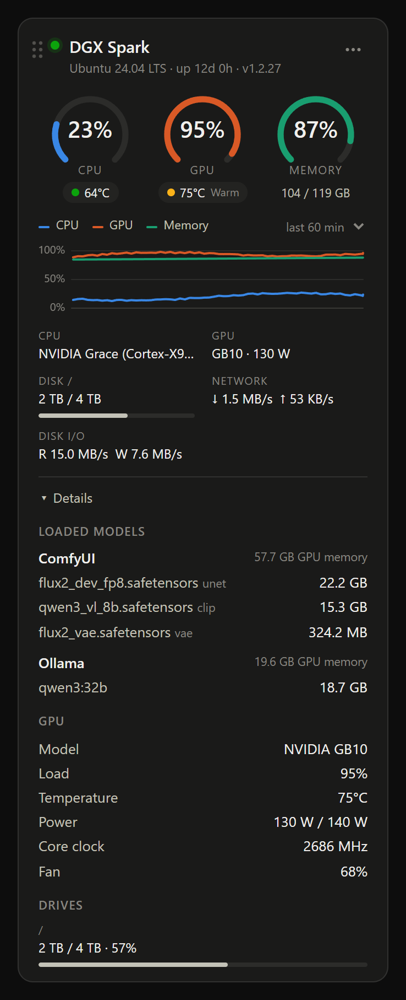
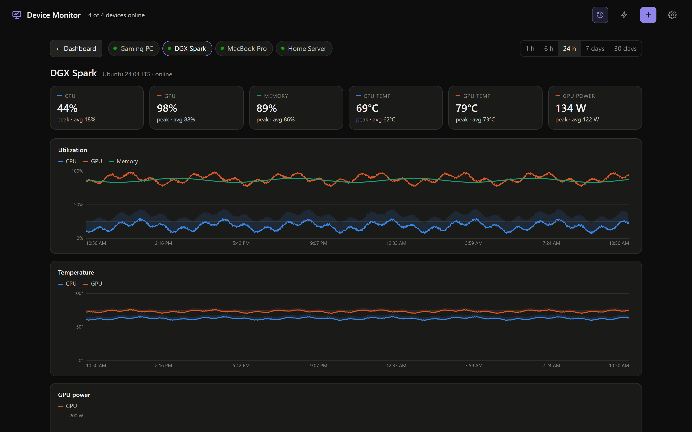
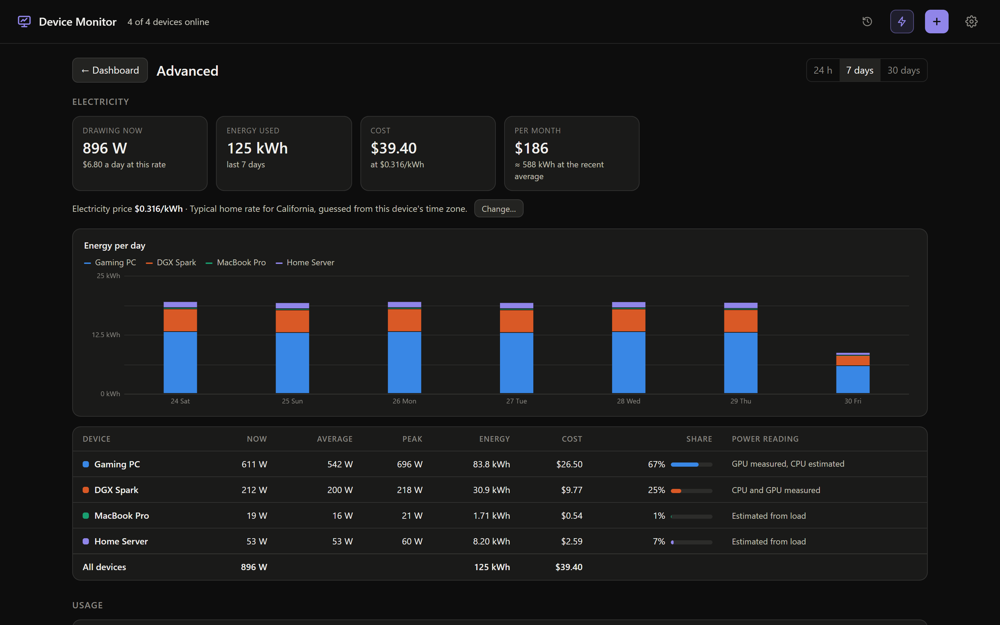

# Device Monitor

A desktop app (Windows and macOS) in the style of NZXT CAM that shows CPU, GPU, memory, temperatures, disks and network for all your machines in one window.



## Install

Run **`dist\Device Monitor Setup <version>.exe`** on Windows (or download it from your hub’s trusted HTTPS `/download` page), or **`Device Monitor.dmg`** on a Mac (see [Mac](#mac)). It installs for your user only (no admin), adds Start menu and desktop shortcuts, and opens the app.

On first launch, pick a role:

- **Host the dashboard here** on your main PC. It runs the hub, monitors itself, and serves the dashboard to other devices. Direct HTTPS hosting on Windows can request permission for its configured TLS port.
- **Connect to a hub** on every other PC. On the host, open **+ → Desktop app** and copy its ten-minute invitation. Paste the entire invitation into Connect. That PC can then report and view the dashboard.

The app starts when you sign in and opens its window (Windows can take up to a minute after sign-in to start it). Closing the window keeps it monitoring in the system tray. The **⚙ Settings** button (top-right of the app window) lets you:

- see whether this computer hosts or which hub it's connected to
- copy the dashboard link
- change setup (switch between Host and Connect)
- allow network access
- turn start-at-sign-in on or off, or start minimized to the tray instead of opening the window
- turn automatic updates on or off
- quit

The tray menu has the same options.

## Using the dashboard



- **Reorder** cards by dragging the ⋮⋮ grip. The order is saved on the hub, so it's the same on every screen.
- **Chart range**: 10 min / 60 min / 6 h in the header.
- **History**: the History button, a card's ⋯ menu, or clicking a card's chart. Pick 1 h to 30 days, hover to inspect, drag across a chart to zoom, double-click to reset. History is stored on the hub (2-second samples for the last hour, 1-minute averages for 30 days).
- **Advanced**: electricity use and cost for each device and in total over 24 hours, 7 days or 30 days. It shows what each device is drawing now, an hour-by-hour or day-by-day energy chart, and a projected monthly cost. It also has usage totals: time online, average and peak load, peak temperatures, data downloaded and uploaded, and disk reads and writes.
- **⚙ Settings** (in the app and in a browser): °C or °F, and your electricity price. The price starts as a typical home rate for where you are, guessed from your time zone. Pick your state or country, or type the rate from your bill. The price is saved on the hub, so every screen uses it.

Power is an estimate of what each device draws from the wall:
- **Measured:** NVIDIA GPU power, and CPU power where there's a sensor (LibreHardwareMonitor on Windows, NVIDIA Grace or RAPL on Linux).
- **Estimated:** an unmeasured CPU (from its load), plus the rest of the system and power-supply losses.

Expect it to be within about 20% of a plug-in power meter.

<br clear="right">

| History | Advanced: electricity and usage |
|---|---|
|  |  |

## Pushing updates to all your devices

On the PC that hosts the hub, from this folder:

```
npm run release                      # bumps the patch version, builds, signs, publishes
npm run release -- --version 1.4.0   # or choose the version
```

The hub tells every connected app right away. Each app:
1. downloads the installer
2. checks the signature and SHA-256
3. shows an **Update to x.y.z** button in the header while the window is open. Click it to restart into the new version now
4. otherwise installs on its own as soon as the window is closed to the tray (or after an hour), and restarts in the background

Progress for each device is in **Settings → Updates**, and each card shows its app version (e.g. `v1.2.3 → 1.2.4` while an update is pending).

- **The release key.** The first `npm run release` creates a signing key at `~/.device-monitor/release-key.pem`. It is not in the repo. **Back it up.** Apps only accept updates signed with it. The public half is `build/update-key.pub.pem` and is built into the app.
- **Apps older than 1.2.0** have no updater. Their dashboard shows a notice with a download button, so they need one manual install.
- **Macs** can't install updates silently without an Apple Developer ID. The app downloads the new `.dmg` from the hub, checks its signature and SHA-256, and then offers to open it (notification, tray menu and Settings → Updates).
- **Standalone agent installations** (e.g. on Linux servers) aren't the app, so they don't update this way. Choose **Reconnect** and run a fresh installer command to refresh them.

## Mac

The Mac app works like the Windows one: install it, choose **Connect to a hub**, and the Mac is registered and can view the dashboard. A Mac can also be the hub.

The Mac app has to be built on macOS (or by GitHub Actions):

```
npm install
npm run dist:mac      # -> dist/Device Monitor.dmg (universal: Apple Silicon + Intel)
```

Or push this folder to GitHub and run the **Build** workflow (`.github/workflows/build.yml`). It produces both the `.dmg` and the Windows installer.

The app isn't notarized, so the first time you open it, **right-click → Open** (or System Settings → Privacy & Security → Open Anyway). CPU and GPU temperatures on a Mac need `brew install smctemp`; everything else works out of the box without sudo.

## Adding devices

- **Another Windows PC**: install the app and choose **Connect**. If you don't want the full app there, use the installer command from the dashboard's **+ Add device** dialog. It installs a small background agent with no admin rights needed.
- **Mac / Linux without the app**: run the `curl … | bash` command from **+ Add device**. It installs a background agent (a LaunchAgent on macOS, a systemd user service on Linux) with no sudo needed.

## Viewing from a phone, tablet or browser

Use **Copy dashboard link** in the tray or the **+** dialog. The one-time link signs in one browser tab for eight hours. Use the same trusted HTTPS address on your LAN or tailnet. A loopback link works only on the hub computer.

## Temperatures

| Sensor | Source |
|---|---|
| NVIDIA GPU temp, power, fan, clock, VRAM | `nvidia-smi` (ships with the driver) |
| CPU temp, motherboard sensors, fan RPM (Windows) | [LibreHardwareMonitor](https://github.com/LibreHardwareMonitor/LibreHardwareMonitor) running in the background |
| CPU temp (Linux) | `coretemp` / `k10temp` / thermal zones |
| AMD/Intel GPU load (Windows) | Windows GPU performance counters |

Windows doesn't expose CPU temperature to normal apps, which is why LibreHardwareMonitor is needed for it.

## Security

The hub serves local clients at `http://127.0.0.1:7777`. Remote browsers and agents require HTTPS. Configure one of these on the hub:

- In the host dashboard, open **+ → Enable Tailscale HTTPS on this hub**. Follow Tailscale’s setup if prompted. The hub advertises the Serve address when it becomes available.
- To serve TLS directly on a private LAN, set `DM_HTTPS_ORIGIN` to the trusted HTTPS origin (for example `https://monitor.home.example:8443`) and `DM_TLS_CERT` and `DM_TLS_KEY` to the PEM certificate chain and private-key paths. The HTTPS listener uses the port in that origin. Install your CA on clients if necessary. The local HTTP and direct HTTPS listeners require different ports.
- For an existing local HTTPS reverse proxy, set `DM_HTTPS_ORIGIN`, leave the two TLS file variables unset and proxy to loopback. Preserve the public Host and overwrite X-Forwarded-Proto with https and X-Forwarded-For with the single actual private client IP. Restrict proxy ingress to your LAN or tailnet.

For automatic desktop reconnection behind a reverse proxy, set `DM_TLS_PROXY_CERT` on the hub to the public PEM certificate chain served by that proxy. Have the renewal job replace this file when it activates the new certificate. Direct HTTPS reads the certificate from the TLS connection. A Tailscale Serve origin can get its current public certificate from the local Tailscale daemon, including when the same certificate is used for LAN HTTPS.

**Upgrading an existing fleet.** Upgrade the hub and desktop apps using trusted installers. Old shared keys, cookies, six-digit codes and old report formats are retired. From the hub’s **+** dialog, select **Reconnect** for each existing device before issuing its new invitation or agent command. Redemption rotates that device’s credentials and preserves its registry entry and history. Re-run the new installer command on standalone agents. Stop older agents until they are re-enrolled, since old binaries can still send their previous telemetry to their saved address. Browser users need a fresh dashboard invitation. Only the hub app or the headless hub’s local operator can enroll or reconnect devices. A paired desktop can share a temporary browser invitation. Ordinary browser sessions cannot issue credentials.

**Access.** Standalone agents receive a reporting credential bound to one device ID. Desktop Connect also receives a separate dashboard credential. When the HTTPS key changes, an updated desktop checks the certificate chain and hostname, then asks the updated hub to prove the new key with a fresh challenge bound to the original origin and the existing desktop enrollment. Only after verifying that proof does it save the new pin and resume dashboard requests and reports. Existing 1.2.30 enrollments, including desktops that were offline during renewal, use the same device ID, credentials and history. Replacing the hub's enrollment database or revoking the device still requires a fresh invitation. Browser sessions last eight hours and stay in origin-specific tab storage. Use **Sign out of this tab**, **Revoke browser access** on the host, or remove/re-enroll a device to revoke its access.

**Installation and updates.** Generated install and uninstall commands require HTTPS. Each installer checks the agent digest before replacing its program. Desktop updates verify the signed release manifest and downloaded bytes, including manual Windows updates. The Windows helper holds the verified file against writes while launching it.

**Local storage.** The hub keeps its local administration key and hashed device credentials in `access-v2.json` under its own data directory. POSIX history files are owner-only. Legacy histories migrate by their recorded device IDs. Ambiguous legacy rows without an ID are preserved in private `.unassigned` files for manual recovery.

**Headless access.** Run `npm run hub`, then run `node server.js --invite` in a second interactive terminal on the hub to print a single-use, ten-minute local operator invitation. Issuing a new headless invitation replaces the previous pending one. Ordinary startup output contains no credential.

## Development

```
npm install
npm start          # run the app from source
npm run dist       # build dist\Device Monitor Setup <version>.exe
npm run dist:mac   # build dist/Device Monitor.dmg (run on a Mac)
npm run hub        # headless hub only (e.g. on a home server), dashboard at :7777
```

| Path | Purpose |
|---|---|
| `main.js` | Electron app: window, tray, setup, host/connect modes, firewall, start with Windows |
| `preload.js`, `app/` | Setup screen and offline screen |
| `server.js` | Hub: API, live stream (SSE), installer scripts, dashboard |
| `discovery.js` | Wake-on-LAN packets and legacy discovery helpers |
| `security.js` | Input validation, Host checks (anti DNS-rebinding), CSP headers |
| `updater.js`, `build/release.js` | Signed self-updates from the hub; the release command |
| `history.js` | Metric history (raw last hour + 1-minute averages for 30 days, on disk) |
| `power.js` | Power estimates (watts at the wall) used for electricity use and cost |
| `agent-runner.js`, `agent/` | Metric agents (Windows PowerShell, macOS and Linux bash) and their one-line installers |
| `build/screenshots.js` | Regenerates the README screenshots in `docs/screenshots/` from a demo hub |
| `build/test/` | Test fixtures: seeded test hub, macOS command mocks for the Mac agent |
| `public/index.html` | Dashboard UI |
| `build/make-icon.js` | Generates the app and tray icons |

App data is stored in `%APPDATA%\Device Monitor`: `settings.json`, plus `hub\` with the device list and access records. The installer isn't code-signed, so Windows SmartScreen may show "Windows protected your PC". Click **More info → Run anyway**.

## License

MIT. See [LICENSE](LICENSE).
